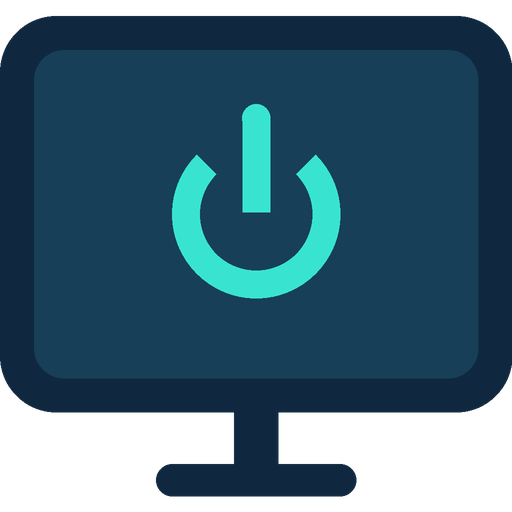

<h1 align="center">TCL Display</h1>

Телевизор как экран Windows — под управлением Home Assistant

<a href="https://github.com/BrainDeLook/tcl-display/releases/latest/download/TCL-Display-Setup.exe"><b>⬇ Скачать установщик Windows</b></a> · <a href="https://my.home-assistant.io/redirect/hacs_repository/?owner=BrainDeLook&amp;repository=tcl-display&amp;category=integration"><b>Добавить в HACS</b></a> · <a href="README.en.md">English</a>

**Приложение, интеграция, иконки и все релизы находятся в этом репозитории.** Для ПК нужен файл **TCL-Display-Setup.exe**. Интеграция устанавливается через HACS; искать её в другом репозитории не требуется.

| Что нужно | Где взять |
| --- | --- |
| Установить или обновить приложение на ПК | [Скачать TCL-Display-Setup.exe](https://github.com/BrainDeLook/tcl-display/releases/latest/download/TCL-Display-Setup.exe) |
| Установить интеграцию в HA | [Открыть HACS](https://my.home-assistant.io/redirect/hacs_repository/?owner=BrainDeLook&repository=tcl-display&category=integration) |
| Полная инструкция и перенос старых настроек | [Инструкция на русском](README.ru.md) |
| Ручная установка интеграции без HACS | [TCL-Display-HA.zip](https://github.com/BrainDeLook/tcl-display/releases/latest/download/TCL-Display-HA.zip) — распаковать в `/config`, затем перезапустить HA |

## Быстрый старт

1. **ПК:** скачай установщик, нажми «Установить» и открой TCL Display из меню «Пуск». Программа хранится в `%LocalAppData%\Programs\TCL Display`, настройки — в `%LocalAppData%\TCL Display`. Старую portable-версию сначала заверши; её `agent.ini` можно перенести через мастер установки.
2. **Приложение:** выбери дисплей, сохрани настройки, разреши доступ HA и запусти обработчик. Во вкладке «Настройка HA» скопируй строку подключения.
3. **HA:** добавь этот репозиторий в обычный HACS как **Интеграцию**, установи TCL Display и перезапусти HA. Для уже установленной версии обновись до **0.4.0**. Если кнопка HACS не открывается, добавь вручную `https://github.com/BrainDeLook/tcl-display`.
4. **Подключение:** Настройки → Устройства и службы → Добавить интеграцию → TCL Display. Вставь строку из приложения. При обновлении повторное подключение не нужно.

## Два переключателя

- **Дисплей Windows** — подключает телевизор к рабочему столу Windows или программно отключает его. Это действие соответствует настройке «Отключить этот дисплей», а не питанию ТВ.
- **Делать ТВ основным** — отдельная настройка в разделе конфигурации устройства. Когда режим включён, следующая команда подключения делает ТВ основным, а отключение возвращает прежний монитор. Память о нём сохраняется после перезапуска. По умолчанию режим выключен.

Привяжи переключатель дисплея к своим существующим скриптам HDMI или медиаплееру. Интеграция сама не переключает входы телевизора.

Приложение нативное, без .NET, Python и HASS.Agent. Есть автозапуск, скрытие в фон и независимая настройка значка в трее. Обновление — повторным запуском установщика, удаление — через список приложений Windows. Настройки сохраняются.

Подключение предназначено для доверенной домашней сети. Не открывай порт в интернет и не публикуй строку подключения: она содержит ключ.

[Все релизы](https://github.com/BrainDeLook/tcl-display/releases) · [Сообщить о проблеме](https://github.com/BrainDeLook/tcl-display/issues)

## Сборка

Исходники Windows — `windows/`, интеграция — `custom_components/tcl_display/`, фирменные изображения — `assets/` и `brand/`. Сборка приложения: `windows/build.ps1` (Zig 0.13); установщика: `windows/build-installer.ps1` (Inno Setup 6). CI проверяет протокол, Home Assistant, HACS, нативную логику, установку, обновление и удаление.
